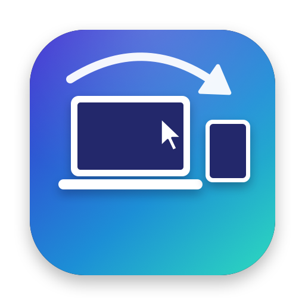
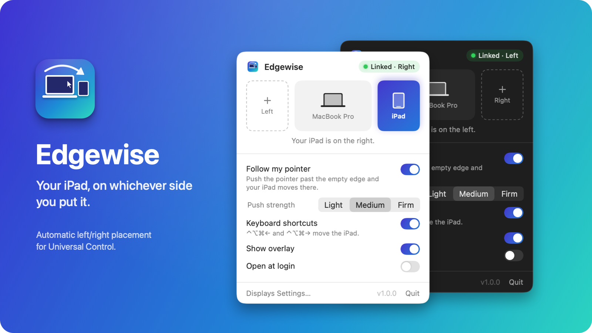
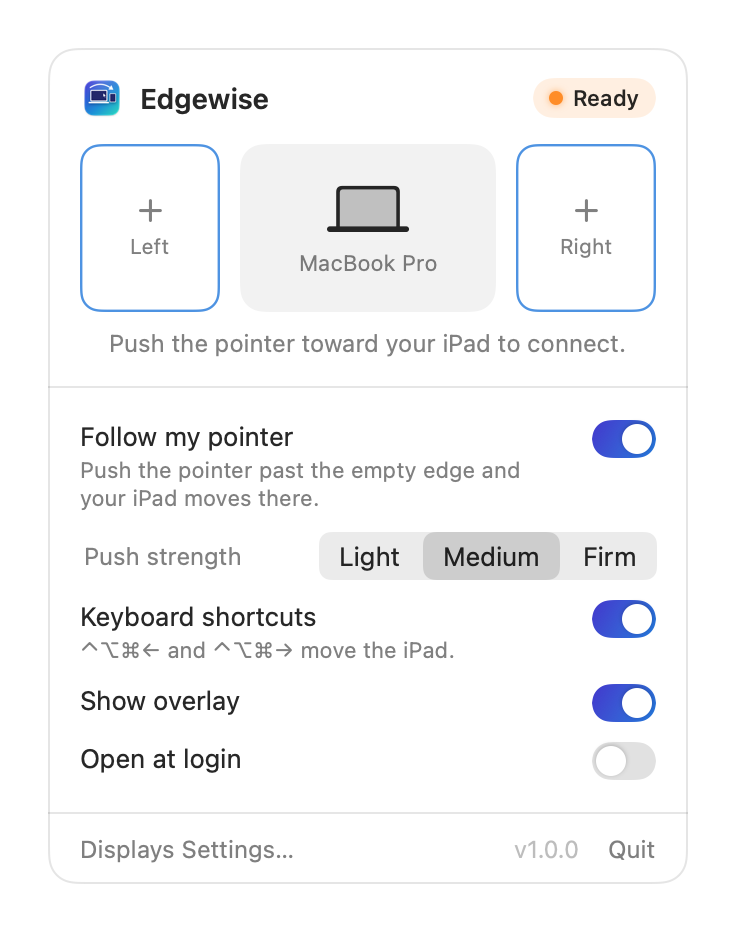
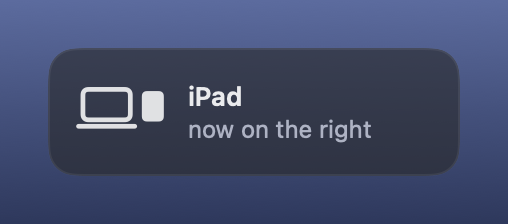
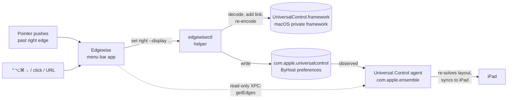

<p align="center">
  
</p>

<h1 align="center">Edgewise</h1>

<p align="center">
  <b>Your iPad, on whichever side you put it.</b><br>
  A tiny menu bar app that moves your iPad to the left or right of your Mac in Universal Control, automatically.<br>
  <a href="https://emcar-alt.github.io/Edgewise/">Website</a> · <a href="https://github.com/emcar-alt/Edgewise/releases/latest">Download</a>
</p>

<p align="center">
  
  
  
  <a href="LICENSE"></a>
</p>

<p align="center">
  
</p>

---

Universal Control remembers which side of your Mac your iPad is on, and macOS has no option to figure that out again. Move the iPad to the other side of your MacBook and the pointer still leaves through the old edge, until you open **System Settings › Displays › Arrange** and drag a tile across.

Edgewise does that for you. Push the pointer toward where your iPad actually is and it's re-linked to that edge in a fraction of a second, so the same push carries you straight onto the iPad.

## Features

- **Follow my pointer.** Push past the empty edge of your screen, the way you would to reach an iPad, and Edgewise moves the iPad there. Adjustable push strength, so slamming the pointer into a scroll bar doesn't count.
- **One click** in the menu bar to put the iPad on the left or right.
- **Keyboard shortcuts:** <kbd>⌃</kbd><kbd>⌥</kbd><kbd>⌘</kbd><kbd>←</kbd> and <kbd>⌃</kbd><kbd>⌥</kbd><kbd>⌘</kbd><kbd>→</kbd>.
- **Automation:** `edgewise://move/left`, `edgewise://move/right` and `edgewise://swap` work from Shortcuts, Raycast, Alfred, Stream Deck or a script.
- **Multiple displays:** the iPad attaches to the display you pushed against, or the outermost display on that side.
- **A command-line tool**, `edgewisectl`, for status, scripting, backup and restore.
- **No permissions to grant.** No Accessibility, Input Monitoring or Screen Recording. No network access, no analytics.
- Universal binary, light and dark mode, and a confirmation overlay that shows where the iPad went.

<table>
  <tr>
    <td align="center"><br><sub>Not linked yet: Universal Control connects on whichever side you push.</sub></td>
    <td align="center"><br><sub>The overlay after a switch.</sub></td>
  </tr>
</table>

## Install

**Download:** grab `Edgewise-x.y.z.zip` from [Releases](../../releases), unzip it and drag **Edgewise** to Applications.

Edgewise isn't notarized yet, so the first time macOS will say it can't verify the developer. Either right-click the app and choose **Open**, or run:

```bash
xattr -dr com.apple.quarantine /Applications/Edgewise.app
```

**Build from source:** all you need is the Xcode Command Line Tools (`xcode-select --install`), not Xcode itself.

```bash
git clone https://github.com/emcar-alt/Edgewise.git
cd Edgewise
make install
```

## Using it

1. Turn on Universal Control on both devices (**System Settings › Displays › Advanced** on the Mac) and connect your iPad once, the normal way.
2. Open Edgewise. The menu bar icon shows a Mac with the iPad on the side it's linked to.
3. Put the iPad wherever you like. When you push the pointer toward it, Edgewise moves the link and the push lands on the iPad.

You can also click the empty slot in the Edgewise window, or use the keyboard shortcuts.

| Setting | What it does |
| --- | --- |
| Follow my pointer | Watches for a deliberate push past an outer screen edge where the iPad isn't, and moves the iPad there. |
| Push strength | Light, Medium or Firm: how far you have to push past the edge. Medium works for most people. |
| Keyboard shortcuts | <kbd>⌃⌥⌘←</kbd> / <kbd>⌃⌥⌘→</kbd> move the iPad left or right. |
| Show overlay | A short confirmation at the screen edge after each move. |
| Open at login | Starts Edgewise when you log in. |

## How "automatic" works

A Mac has no sensor that can tell where an iPad is physically sitting. Bluetooth signal strength gives distance, not direction, and Macs don't have the Ultra Wideband chip that gives iPhones direction-finding. So Edgewise detects **intent** instead of position.

When the pointer is pressed against an outer edge of your screens, Edgewise adds up how far you keep pushing. A real attempt to reach a device on that side is a long, continuous push; hitting the edge to reach a scroll bar or a sidebar is short. Once a continuous push passes the threshold for your chosen strength (and the iPad isn't already there), Edgewise re-links the iPad to that edge. Universal Control picks the change up within milliseconds, so if you're still pushing you go straight across.

Pushes against the edge where the iPad already is are ignored, and nothing happens while Universal Control is still searching (unlinked, it already connects on whichever edge you push through).

## How it works



- Universal Control stores your arrangement in the ByHost preferences of `com.apple.universalcontrol`, as a hash-chained log of *links* such as `Mac:display/left@0.50 = iPad/right@0.50`. The log syncs between your devices, and every entry is keyed by a SHA-256 digest.
- Edgewise doesn't reimplement that format. Its helper, `edgewisectl`, loads macOS's own private `UniversalControl.framework`, decodes the stored configuration, removes the old link between your Mac and iPad, adds the mirrored one and re-encodes it, so every digest is computed by Apple's code. It round-trips the result before writing anything.
- The Universal Control agent watches those preferences and re-solves the layout right away (`Configuration Changed … right@0.50`). Edgewise confirms the new edge through the agent's read-only XPC call `getEdges`, and only restarts the agent if the change doesn't appear.
- The app itself never loads the private framework. The helper runs as a separate process, so if a future macOS changes the framework, the helper fails to launch and Edgewise tells you, instead of crashing or writing anything.
- The first time it runs, Edgewise saves your original arrangement to `~/Library/Application Support/Edgewise/Original Arrangement.plist`.

The [`PrivateAPI/`](PrivateAPI) folder has the Swift interface for the framework and notes on how its ABI was worked out.

## Command line

`edgewisectl` lives inside the app bundle. Every command prints JSON.

```bash
alias edgewisectl=/Applications/Edgewise.app/Contents/Helpers/edgewisectl

edgewisectl status                 # this Mac, linked devices, live edges and displays
edgewisectl set right              # move the most recently linked iPad to the right
edgewisectl set left --dry-run     # show the link that would be written
edgewisectl set top --display <UUID>
edgewisectl backup ~/Desktop/uc.plist
edgewisectl restore ~/Desktop/uc.plist
edgewisectl dump                   # the raw configuration history
```

## Compatibility

- Tested on **macOS 26.4 Tahoe** on Apple Silicon, with an iPad over Universal Control. The Intel slice was tested under Rosetta.
- Edgewise relies on private macOS internals. A macOS update can change them; when that happens Edgewise shows a notice and stops moving the iPad rather than guessing.
- It moves the iPad you linked most recently. With several iPads or Macs, the others stay where they are.

## FAQ

**Does it work with Sidecar?** No. Sidecar turns the iPad into a regular display, which you can already arrange in System Settings. Edgewise is for Universal Control, where the iPad keeps its own screen.

**Does it need any permissions?** No. Watching pointer movement doesn't require Accessibility or Input Monitoring, and the keyboard shortcuts use the standard hot key API.

**Can it move the iPad above or below?** From the command line: `edgewisectl set top` or `set bottom`. The app sticks to left and right.

**How do I undo a move?** Click the other slot, run `edgewisectl set left` (or `right`), or drag the iPad in System Settings › Displays. Your arrangement from before Edgewise's first launch is also saved, and `edgewisectl restore ~/Library/Application\ Support/Edgewise/Original\ Arrangement.plist` writes it back. Because the arrangement syncs with your iPad, a newer change on the iPad's side can still win after a restore; moving the iPad with `set` always wins.

## Development

```text
Sources/Edgewise/       menu bar app (SwiftUI + AppKit)
Sources/edgewisectl/    helper that reads and writes the arrangement
PrivateAPI/             Swift interface + .tbd stub for UniversalControl.framework
Tests/                  pointer-push logic tests
scripts/                build, test, icon and README art
```

```bash
make          # build/Edgewise.app for this Mac's architecture
make run      # build and launch
make test     # unit tests
make zip      # universal build, zipped for a release
make icon     # regenerate the app icon
```

`build/Edgewise.app/Contents/MacOS/Edgewise --snapshot <folder>` renders the window in every state for screenshots. If a macOS update changes the framework, `scripts/gen-tbd.sh` checks every symbol the helper uses against the installed framework.

## License

[MIT](LICENSE) © 2026 Ethan Mathias. Not affiliated with Apple. Universal Control, iPad and Mac are trademarks of Apple Inc.
